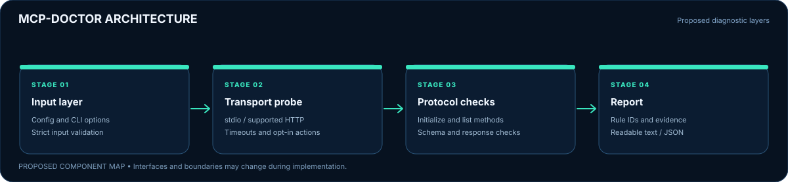
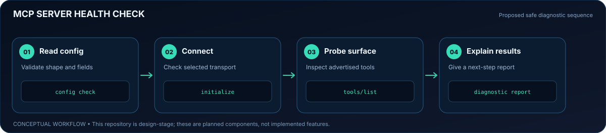
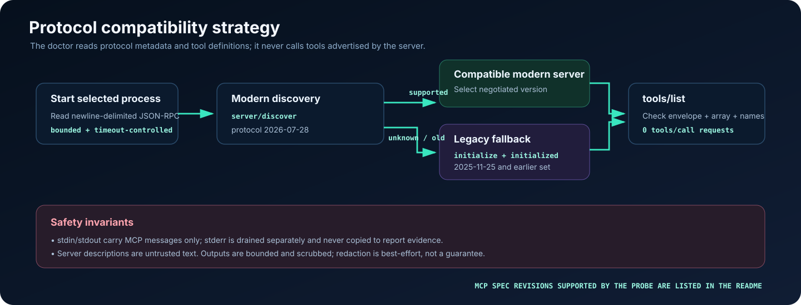
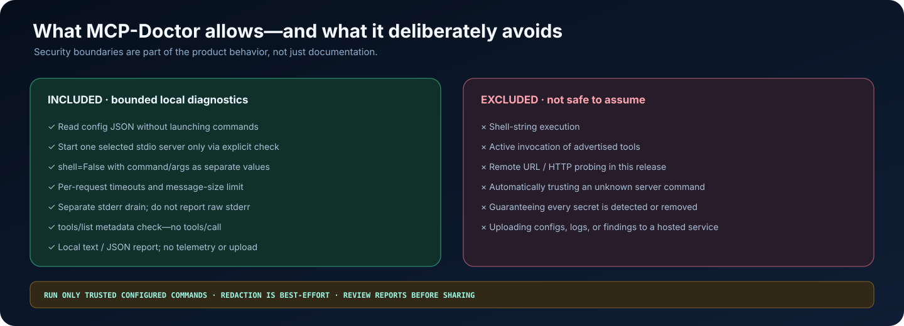

# MCP-Doctor

<p align="center">
  
</p>

<p align="center">
  <strong>A local-first diagnostic CLI for Model Context Protocol servers.</strong><br/>
  <sub>Find configuration, startup, protocol-handshake, and tool-catalogue problems before debugging the client application.</sub>
</p>

<p align="center">
  <a href="#quick-start">Quick start</a> ·
  <a href="#visual-system-guide">Visual system guide</a> ·
  <a href="docs/DIAGNOSTIC-RULES.md">Rule catalogue</a> ·
  <a href="docs/CONFIGURATION.md">Configuration</a> ·
  <a href="SECURITY.md">Security</a>
</p>

<p align="center">
  
  
  
  <a href="https://github.com/muhammadsaeed-ai/MCP-Doctor/actions/workflows/ci.yml"></a>
  
</p>

> **Project status: early implementation (v0.2.0).** MCP-Doctor currently validates JSON configuration and probes **local stdio servers**. Remote HTTP transports, server-specific config discovery, and active tool calls are not implemented. This README separates working behavior from future ideas.

---

## What it does

MCP clients depend on multiple layers working together: configuration, executable resolution, process startup, protocol negotiation, and valid tool metadata. MCP-Doctor checks those layers and returns stable diagnostic rule IDs, evidence, severity, and a suggested next step.

- **Configuration validation without execution** — check JSON syntax and the shape of known `mcpServers` entries without launching a configured command.
- **Explicit stdio probe** — start one selected local process only when `check` is invoked.
- **Modern and legacy protocol paths** — try MCP's `server/discover` flow for protocol revision `2026-07-28`, then fall back to known earlier `initialize` handshake revisions when appropriate.
- **Bounded communications** — request timeouts, message-size limits, newline-delimited JSON-RPC, and stderr draining separate from protocol stdout.
- **Tool-catalogue checks** — validate the `tools/list` response shape and identify malformed or duplicate tool entries; the probe never invokes `tools/call`.
- **Explainable findings** — stable rule IDs, error/warning/pass level, concise evidence, and corrective next steps.
- **Text and JSON reports** — readable terminal output and a versioned machine-readable schema at [docs/report.schema.json](docs/report.schema.json).
- **No telemetry and no runtime dependencies** — the diagnostic flow is local; optional development dependencies are only for tests, lint, and builds.

## Quick start

Requires Python 3.10 or newer.

```bash
git clone https://github.com/muhammadsaeed-ai/MCP-Doctor.git
cd MCP-Doctor
python -m pip install -e .
```

For development:

```bash
python -m pip install -e ".[dev]"
pytest
ruff check src tests
```

## Try it against an MCP client config

Save the example configuration from [examples/mcpServers.example.json](examples/mcpServers.example.json) or use an existing MCP client configuration you trust.

### 1. Validate the configuration first

```bash
mcp-doctor validate ./mcpServers.json
```

This reads JSON only. It does **not** run any configured server process.

### 2. See which local stdio servers are configured

```bash
mcp-doctor servers ./mcpServers.json
```

### 3. Run a live, bounded check

```bash
mcp-doctor check ./mcpServers.json --server filesystem-local
```

If the config contains a single checkable server, `--server` can be omitted. When multiple servers exist, selecting one is required. **The check command starts the chosen configured executable. Only run this against server commands you trust.**

Increase the per-request timeout or choose JSON output for automation:

```bash
mcp-doctor check ./mcpServers.json --server filesystem-local --timeout 10
mcp-doctor check ./mcpServers.json --server filesystem-local --format json > report.json
```

Per-request timeout is limited to 0.1–120 seconds. The default maximum protocol line size is 1 MiB; tune it explicitly only when a trusted server legitimately needs larger protocol messages.

## Visual system guide

These diagrams are part of the repository, not screenshots of an external product. Each one explains a different aspect of the implementation.

### 1. Architecture: from config to evidence-led report

<p align="center"></p>

The code is split into configuration parsing, runtime command validation, a bounded stdio JSON-RPC session, protocol compatibility logic, and report rendering. Configuration-only commands never launch a process. A live check lists tool definitions but does not call them.

### 2. The diagnostic workflow

<p align="center"></p>

A failed step produces an actionable finding instead of a bare “connection failed” message. The CLI exits with status 1 when error-severity findings exist and 0 otherwise; invalid CLI arguments use argparse's usage handling.

### 3. Protocol compatibility: modern discovery and legacy fallback

<p align="center"></p>

The modern branch uses the `2026-07-28` discovery metadata. If discovery is unavailable or the server advertises an older revision, MCP-Doctor tries the supported legacy initialize versions documented in its implementation. See the official [MCP specification changelog](https://github.com/modelcontextprotocol/modelcontextprotocol/blob/main/docs/specification/2026-07-28/changelog.mdx) and [stdio transport](https://github.com/modelcontextprotocol/modelcontextprotocol/blob/main/docs/specification/2026-07-28/basic/transports/stdio.mdx).

### 4. What stays inside the diagnostic boundary

<p align="center"></p>

The default probe avoids invoking tools or sending report data to a hosted service. The configured server is still a local executable, so use `check` only with commands you trust. Redaction is best-effort, not a guarantee.

## Understanding an example finding

Illustrative output — the exact rules depend on the server and config being checked:

```text
✖ [ERROR  ] MCPD-PROTO-010 · Server exited before responding
  The server closed stdout before sending the requested response.
  Next: Launch the configured command in a trusted terminal and inspect
        startup diagnostics on stderr.
```

A JSON report includes a versioned top-level `schema_version`, a summary, protocol metadata, safe tool descriptors, timings, and structured findings. Each finding contains a rule ID, severity, message, next step, area, and evidence fields.

Read the complete catalogue at [docs/DIAGNOSTIC-RULES.md](docs/DIAGNOSTIC-RULES.md). Rule IDs are designed for useful automation, but exact wording may improve as the project evolves.

## Command reference

| Command | Executes a server process? | Purpose |
| --- | --- | --- |
| `mcp-doctor --version` | No | Show package version |
| `mcp-doctor validate CONFIG` | **No** | Parse JSON and validate the supported config shape |
| `mcp-doctor servers CONFIG` | **No** | List known local stdio entries |
| `mcp-doctor check CONFIG` | **Yes** | Probe one trusted configured server |
| `mcp-doctor check CONFIG --server NAME --format json` | **Yes** | Select a server and emit machine-readable results |

See [docs/CONFIGURATION.md](docs/CONFIGURATION.md) for config fields, environment variables, and the selection behavior.

## Diagnostic coverage

| Layer | Implemented checks | Current boundary |
| --- | --- | --- |
| Configuration | JSON parse, top-level shape, command/args/env/cwd types | JSON only; not every vendor dialect |
| Executable | PATH/file resolution, cwd existence, environment-placeholder detection | Does not install missing runtimes |
| Process | Start errors, shell-free invocation, bounded shutdown | Only a trusted local process |
| MCP protocol | Modern discovery and legacy initialize; request/response envelopes | No transport switching or full schema validation |
| Tools catalogue | `tools/list` response, named entries, duplicate names, basic inputSchema shape | Never executes tool functions |
| Reports | Text/JSON, stable rule IDs, evidence and next step | Secret scrubbing is best-effort |
| Remote servers | Not implemented | URL/HTTP transport is reported as unsupported |

## Security model and limitations

1. **Configuration is executable intent.** `validate` and `servers` do not execute commands, but `check` starts the selected one. Review the command and arguments first.
2. **No shell string.** The executable and argument list are passed to a subprocess with `shell=False`.
3. **Bounded read.** Each protocol request has a timeout and each JSON-RPC line is checked against a configured byte limit.
4. **Stdout is protocol-only.** A server that writes logs to stdout can break the check; logs belong on stderr.
5. **No active calls.** MCP-Doctor never sends `tools/call` in the default diagnostic flow.
6. **No secret guarantee.** Diagnostic text is scrubbed for common credential patterns and capped, but not all secrets can be recognized. Review reports before sharing them.

Full details: [SECURITY.md](SECURITY.md).

## Repository map

```text
src/mcp_doctor/
├── cli.py          # CLI and exit behavior
├── config.py       # JSON config parsing + command validation
├── diagnostics.py  # Orchestration of safe checks
├── models.py       # Structured findings and report schema
├── redact.py       # Best-effort report-text scrubbing
├── report.py       # Text and JSON renderers
└── stdio.py        # Subprocess, JSON-RPC, protocol fallback, tool list checks
tests/
├── fixtures/       # Synthetic local MCP server
└── test_*.py       # Config, protocol, and report tests
assets/readme/      # Explanatory SVGs and small animated workflow indicator
docs/               # Configuration, architecture, rule IDs, report schema
```

## Development and contribution

```bash
python -m pytest
ruff check src tests
python -m build
```

The tests use a synthetic local server and do not require a real MCP server or network access. See [CONTRIBUTING.md](CONTRIBUTING.md) for test expectations and [SECURITY.md](SECURITY.md) for reporting concerns.

## Roadmap

- [x] Read-only configuration validation
- [x] Explicit stdio diagnostic command
- [x] Modern discovery and legacy initialize fallback
- [x] Bounded request waits and protocol message limits
- [x] Read-only tool catalogue inspection
- [x] Stable findings and JSON/text outputs
- [ ] Deep JSON Schema validation for tool input schemas
- [ ] Cross-platform termination behavior review and additional process lifecycle fixtures
- [ ] Remote Streamable HTTP diagnostics (separate security review required)
- [ ] More client-specific config adapters

## License

MIT. See [LICENSE](LICENSE).

## Topics

`model-context-protocol` · `mcp` · `mcp-server` · `mcp-client` · `mcp-debugging` · `protocol-diagnostics` · `developer-tools` · `cli` · `json-rpc` · `ai-tools` · `stdio` · `python`
